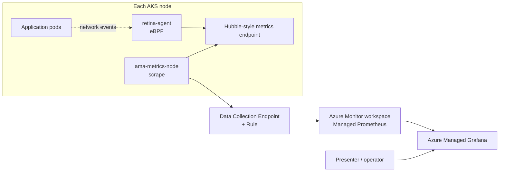
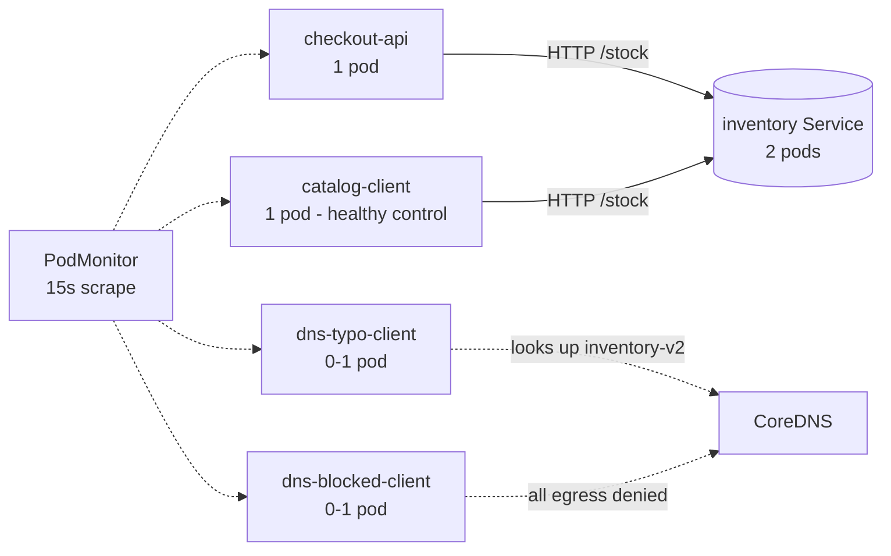

# ACNS on AKS: step-by-step implementation and advanced incident demo

**Historical validation:** 19 October 2026 on a reference Azure CNI Overlay cluster. Measurements below describe that rehearsal, not a new validation of your environment. Where something is a recommendation and was **not** executed, it is explicitly labelled *Not executed*.

> **Public version:** live workspace endpoints, subscription identifiers, and identity identifiers have been replaced with placeholders. Screenshots, raw evidence, exported documents, and original guides remain local and are excluded from GitHub. Figure captions and evidence filenames identify historical observations; they are not dependencies of this public guide. Follow the dashboard instructions to observe your own run.

## How to use this document

| Part | Purpose | Read it if you want to... |
|---|---|---|
| 1. Executive summary | One-page overview | Brief an executive or set expectations |
| 2. Concepts | What ACNS observability is and is not | Explain the feature accurately |
| 3. Implementation (step by step) | Enable ACNS, Managed Prometheus and Grafana | Reproduce the setup in your own cluster |
| 4. The use case deployed on AKS | What runs in the cluster and why | Understand the demo application and dashboard |
| 5. Scenario execution with evidence | Recorded measurements, historical observations, and live dashboard instructions | Present or review results |
| 6. Presenter guide | Run of show and talk track | Deliver the demo to a customer |
| 7. Operations, scope and limitations | Honest boundaries, security, cost, next steps | Position the feature and plan production use |
| Appendices | File inventory, PromQL, evidence index, regeneration steps | Reuse or audit the material |

Optional local screenshots are in `images/advanced/`; raw command output and measurements are in `evidence/`. Neither folder is published. Repository links in this document are relative to the `docs` folder.

---

## 1. Executive summary

Advanced Container Networking Services (ACNS) adds **pod-level network observability** to AKS. Kubernetes reports whether a pod is *Running*; ACNS reports whether traffic between pods is being *forwarded, dropped, answered or delayed*, attributed to Kubernetes workloads.

This guide:

1. Shows exactly how ACNS Container Network Observability was enabled on an Azure CNI Overlay cluster, together with Azure Managed Prometheus and Azure Managed Grafana (Part 3).
2. Describes the synthetic "checkout" application deployed to demonstrate it (Part 4).
3. Documents four fault cases and one resilience scenario against that application, including the recorded measurements and the dashboard views to reproduce (Part 5). Original Playwright screenshots remain private.

### Result at a glance

| Scenario | What was injected | What a Kubernetes-only view shows | What ACNS adds | Measured evidence |
|---|---|---|---|---|
| 1. Policy regression | NetworkPolicy omitted `checkout-api` | All pods Running | Drops attributed to `checkout-api`, reason `policy_denied` | Success 100% to 0%; ACNS drops 0 to 1.78/s; p95 24 ms to 2.42 s; `catalog-client` stayed at 100% |
| 2a. DNS wrong name | Client resolves a non-existent service name | Pod Running | DNS return code `non-existent domain` | 29.2 NXDOMAIN responses/s |
| 2b. DNS blocked | Policy denies all egress including DNS | Pod Running | DNS queries with no responses, plus `policy_denied` drops | 1.51 queries/s, 1.44 drops/s, no responses |
| 3. Slow dependency | 800 ms added inside the application | All healthy | Latency rises for every caller while ACNS drops stay at zero (rules the network out) | p95 24 ms to 975 ms for both callers; 0 drops; success 100% |
| 4. Pod replacement | One backend pod deleted | New pod appears | Lifecycle event, not a network drop | Replacement `inventory-5ffbd9b85f-5tl85` Ready; success stayed 100% |


*Figure 1. The complete 40-minute timeline (17:40 to 18:20). Orange markers are scenario steps posted by the runner.*

---

## 2. Concepts

### 2.1 What ACNS Container Network Observability provides

ACNS is a suite of AKS networking features. This guide uses **Container Network Observability**:

- Node-level and pod-level network metrics in Prometheus format.
- On non-Cilium dataplanes (this cluster) the agent is **Microsoft Retina** (eBPF), exposing Hubble-style metrics.
- Metrics are scraped by Azure Managed Prometheus (`ama-metrics`), stored in an Azure Monitor workspace and visualised in Azure Managed Grafana.

Source: [Container network metrics](https://learn.microsoft.com/azure/aks/container-network-observability-metrics) and [Set up Container Network Observability](https://learn.microsoft.com/azure/aks/container-network-observability-how-to).

### 2.2 Data path



### 2.3 What is enabled on this cluster

From local-only record `11-aks-network-acns.txt`:

| Setting | Value | Meaning |
|---|---|---|
| `networkPlugin` / `networkPluginMode` | `azure` / `overlay` | Azure CNI Overlay; pods use a private overlay CIDR |
| `networkDataplane` | `azure` | **Not Cilium** |
| `networkPolicy` | `azure` | Azure Network Policy enforces Kubernetes NetworkPolicy |
| `advancedNetworking.enabled` | `true` | ACNS is on |
| `advancedNetworking.observability.enabled` | `true` | Container Network Observability is on |
| `advancedNetworking.security.enabled` | `false` | Container Network Security (FQDN policy etc.) is **off** and requires Cilium |
| `azureMonitorProfile.metrics.enabled` | `true` | Managed Prometheus is collecting |
| Pod CIDR / service CIDR | `192.168.0.0/16` / `10.0.0.0/16` | |

### 2.4 Metric families observed on this cluster

Queried from the Prometheus label API (metric names starting `hubble` or `networkobservability`):

| Family | Metric names (observed) | Granularity |
|---|---|---|
| Hubble (pod-level) | `hubble_drop_total`, `hubble_dns_queries_total`, `hubble_dns_responses_total`, `hubble_tcp_flags_total` | Per source/destination pod (`source`, `destination` labels) |
| Network observability (node-level) | `networkobservability_drop_count`, `networkobservability_drop_bytes`, `networkobservability_forward_count`, `networkobservability_forward_bytes`, `networkobservability_dns_request_count`, `networkobservability_dns_response_count`, `networkobservability_tcp_connection_stats`, `networkobservability_tcp_connection_remote`, `networkobservability_tcp_state`, `networkobservability_udp_connection_stats`, `networkobservability_interface_stats` | Per node (`instance` label) |

Labels used in this guide (verified against live series): `source`, `destination` (format `namespace/pod`), `reason` (for example `policy_denied`), `rcode` (for example `non-existent domain`), `flag` (for example `syn`), `qtypes`, `cluster`, `instance`.

> **Not scraped by default:** `hubble_flows_processed_total`. The Pod Flows dashboards therefore show gaps unless the `ama-metrics-settings-configmap` is changed (see step 3.12).

### 2.5 Dataplane differences (positioning)

| Capability | This cluster (Azure dataplane) | Cilium dataplane |
|---|---|---|
| Node-level and pod-level metrics (Linux) | Yes | Yes |
| Source-level metric filtering (namespace, label, metric type) | No | Yes |
| Container Network Security (FQDN filtering, L7 policy) | No | Yes |
| DNS metrics | Yes (per return code and query type) | Requires a Cilium FQDN network policy |

Source: [Container network metrics overview](https://learn.microsoft.com/azure/aks/container-network-observability-metrics).

---

## 3. Implementation: enable ACNS step by step

Two paths are provided. Path A creates a new cluster. Path B enables ACNS on an existing cluster, which is how `aks-overlay-netobs-demo` was configured by [deploy-demo.ps1](../deploy-demo.ps1).

### 3.1 Prerequisites

| Item | Requirement | Validated value |
|---|---|---|
| Azure CLI | 2.56.0 or later | 2.90.0 (local-only record `10-az-version.txt`) |
| `kubectl` | Compatible with the AKS version | Installed; cluster is Kubernetes 1.35 |
| PowerShell | 5.1 or 7 (demo scripts) | Both tested |
| Network dataplane | Azure CNI or Azure CNI Overlay (Cilium or non-Cilium) | Azure CNI Overlay, Azure dataplane |
| Region and version | Supported by ACNS | swedencentral, Kubernetes 1.35 |
| Node OS | Not Azure Linux 2.0 (retired); Ubuntu or Azure Linux 3 | Ubuntu 24.04 |

**Permissions needed by the operator** (use least privilege; avoid subscription Owner solely for this):

| Task | Typical role |
|---|---|
| Create/update AKS, Azure Monitor workspace, Grafana, data collection resources | Contributor on the resource group (plus ability to create role assignments for the Grafana identity) |
| Get cluster credentials and deploy namespace resources | Azure Kubernetes Service Cluster User + Kubernetes RBAC (or cluster admin for the demo) |
| View dashboards | **Grafana Viewer** |
| Publish dashboards and annotations | **Grafana Editor** (or Admin) |

Sign in and select the subscription:

```powershell
az login --tenant <tenant-id>
az account set --subscription <subscription-id-or-name>
az --version
```

### 3.2 Set variables

```powershell
$subscriptionId = "<subscription-id>"
$resourceGroup  = "rg-aks-netobs-demo"
$location       = "swedencentral"
$clusterName    = "aks-overlay-netobs-demo"
$monitorName    = "amw-overlay-netobs-demo"
$grafanaName    = "amg-netobs-<unique-suffix>"   # must be globally unique
```

Before using the advanced runner, configure the process-local variables in the [README](../README.md#advanced-demo-configuration), using the resources created below. Keep that terminal open for subsequent commands. The runner and evidence helpers no longer contain a default live Grafana endpoint or resource name.

### 3.3 Compatibility gate (existing clusters only)

Record the current configuration before changing anything:

```powershell
az aks show -g $resourceGroup -n $clusterName `
  --query "{version:kubernetesVersion,plugin:networkProfile.networkPlugin,mode:networkProfile.networkPluginMode,dataplane:networkProfile.networkDataplane,policy:networkProfile.networkPolicy,acns:networkProfile.advancedNetworking}" -o json
```

Decision table:

| Finding | Action |
|---|---|
| Plugin is `azure` (CNI or Overlay) | Supported. Continue |
| Plugin is `kubenet` | Not supported for this guide. Migrate to Azure CNI Overlay first |
| `networkPolicy` is empty | Policy-based scenarios need a policy engine. Enable Azure Network Policy (step 3.5) |
| Dataplane is `cilium` | Supported; also unlocks Container Network Security and metric filtering |
| Node OS is Azure Linux 2.0 | Upgrade the node pool before enabling |

### 3.4 Path A: create a new cluster with ACNS

```powershell
az group create --name $resourceGroup --location $location

az aks create `
  --resource-group $resourceGroup --name $clusterName --location $location `
  --node-count 2 --node-vm-size Standard_D2s_v5 `
  --enable-managed-identity `
  --network-plugin azure --network-plugin-mode overlay `
  --network-policy azure --pod-cidr 192.168.0.0/16 `
  --enable-acns `
  --generate-ssh-keys
```

For a **Cilium** dataplane, replace `--network-policy azure` with `--network-dataplane cilium` (Kubernetes 1.29 or later). Source: [Microsoft Learn](https://learn.microsoft.com/azure/aks/container-network-observability-how-to?tabs=non-cilium).

### 3.5 Path B: enable ACNS on an existing cluster

This is the exact sequence executed by `deploy-demo.ps1` against `aks-overlay-netobs-demo`:

```powershell
az aks update -g $resourceGroup -n $clusterName --enable-managed-identity
az aks update -g $resourceGroup -n $clusterName --network-policy azure   # only if no policy engine yet
az aks update -g $resourceGroup -n $clusterName --enable-acns
```

Each `az aks update` can take several minutes. ACNS deploys `retina-agent` (one per node) and `retina-operator`.

### 3.6 Create the Azure Monitor workspace (Managed Prometheus store)

```powershell
az resource create -g $resourceGroup `
  --namespace Microsoft.Monitor --resource-type accounts `
  --name $monitorName --location $location --properties '{}'
```

### 3.7 Create Azure Managed Grafana

Simplest form:

```powershell
az grafana create --name $grafanaName --resource-group $resourceGroup
```

The reference environment used a REST call to create a **Standard** SKU workspace with a system-assigned identity, API keys disabled and public access enabled (see [deploy-demo.ps1](../deploy-demo.ps1)). Resulting properties (local-only record `12-grafana-integration.txt`): name `<grafana-name>`, SKU `Standard`, Grafana `12.4.8`.

### 3.8 Link Prometheus and Grafana to the cluster

```powershell
$monitorId = az resource show -g $resourceGroup -n $monitorName `
  --resource-type Microsoft.Monitor/accounts --query id -o tsv
$grafanaId = az grafana show -g $resourceGroup -n $grafanaName --query id -o tsv

az aks update -g $resourceGroup -n $clusterName `
  --enable-azure-monitor-metrics `
  --azure-monitor-workspace-resource-id $monitorId `
  --grafana-resource-id $grafanaId
```

What this step creates (verified in local-only record `14-resource-group-inventory.txt` and by role query):

- A Data Collection Endpoint and Data Collection Rule named `MSProm-<region>-<cluster>`.
- Prometheus recording rule groups (Kubernetes, Node and UX rules, Linux and Windows).
- The `ama-metrics` collectors in `kube-system`.
- A link from Grafana to the Azure Monitor workspace.
- A **Monitoring Data Reader** role assignment for the Grafana managed identity on the Azure Monitor workspace. Resolve the identity and scope from your own resources; historical identity identifiers are not published.

### 3.9 Get credentials and verify the collectors

```powershell
az aks get-credentials -g $resourceGroup -n $clusterName --overwrite-existing
kubectl get pods -n kube-system -o wide | Select-String "retina|ama-metrics|hubble"
```

Actual output (local-only record `15-kube-system-acns-pods.txt`):

```text
ama-metrics-67498cbcbd-frjtd              2/2   Running   0   3d17h
ama-metrics-67498cbcbd-wpvx7              2/2   Running   0   3d17h
ama-metrics-ksm-846db5bfb4-5jx7s          1/1   Running   0   3d17h
ama-metrics-node-gg249                    2/2   Running   0   5h8m
ama-metrics-node-lhd6c                    2/2   Running   0   5h8m
ama-metrics-operator-targets-bdbb77f9-r8gjg 2/2 Running   3 (5h4m ago)   3d17h
hubble-relay-7c5594c995-r5mvd             1/1   Running   0   5h8m
retina-agent-8txbv                        1/1   Running   0   5h8m
retina-agent-z88tn                        1/1   Running   0   5h8m
retina-operator-6667c46cc7-mb6fh          1/1   Running   0   5h7m
```

Expected pattern: **one `retina-agent` and one `ama-metrics-node` per node**, one `retina-operator`, `ama-metrics` replicas, `ama-metrics-ksm`, and `hubble-relay`. All `Running`.

### 3.10 Verify metrics reach Managed Prometheus

Query the workspace directly (no Grafana needed):

```powershell
$token = az account get-access-token --resource https://prometheus.monitor.azure.com --query accessToken -o tsv
$endpoint = az resource show -g $resourceGroup -n $monitorName --resource-type Microsoft.Monitor/accounts `
  --query properties.metrics.prometheusQueryEndpoint -o tsv
$query = [uri]::EscapeDataString('count(hubble_dns_responses_total)')
Invoke-RestMethod -Uri "$endpoint/api/v1/query?query=$query" -Headers @{ Authorization = "Bearer $token" }
```

Success criteria: non-empty `data.result`. Allow **5 to 10 minutes** after enablement. The Azure Monitor workspace query endpoint for the reference environment is recorded in local-only record `13-azure-monitor-workspace.txt`.

> **Tip:** the query API rejects regular-expression metric-name matchers (`{__name__=~"hubble_.*"}` returns *Metric name only support equality filter*). Use the label API (`/api/v1/label/__name__/values`) to list names, or query exact names.

### 3.11 Open Grafana and find the dashboards

Resolve the Grafana endpoint from your workspace and sign in with Microsoft Entra ID:

```powershell
$env:ACNS_GRAFANA_ENDPOINT = az grafana show -g $resourceGroup -n $grafanaName --query properties.endpoint -o tsv
if ($LASTEXITCODE -ne 0) { throw "Unable to resolve Grafana endpoint" }
Start-Process $env:ACNS_GRAFANA_ENDPOINT
```

The following managed dashboards were present under **Dashboards > Azure Managed Prometheus**:

| Dashboard | UID | Use |
|---|---|---|
| Kubernetes / Networking / Clusters | - | Cluster-wide traffic, drops |
| Kubernetes / Networking / Drops (Workload) | `NetObsDropsWorkload6738` | Drops by workload, reason and pod |
| Kubernetes / Networking / DNS (Cluster) | `NetObsDNS6738` | Cluster DNS health |
| Kubernetes / Networking / DNS (Workload) | `NetObsDNSWorkload6738` | Per-workload DNS requests, responses, errors |
| Kubernetes / Networking / Pod Flows (Namespace / Workload) | - | Flow-level views (needs step 3.12) |
| Kubernetes / Networking / L7 (Namespace / Workload) | - | L7 views (Cilium-dependent data) |
| Kubernetes / Compute Resources / Namespace (Pods) | - | Pod counts and status |

The dashboards use the `source` and `destination` labels with the pattern `namespace/pod`, and a workload variable derived from the pod name with the ReplicaSet hash removed.

### 3.12 Optional: populate Pod Flows panels

`hubble_flows_processed_total` is excluded by default because of cardinality. To collect it, edit `ama-metrics-settings-configmap` (default template: [Azure/prometheus-collector](https://github.com/Azure/prometheus-collector/blob/main/otelcollector/configmaps/ama-metrics-settings-configmap.yaml)): in `default-targets-metrics-keep-list`, change `networkobservabilityHubble = ""` to `networkobservabilityHubble = "hubble.*"`, then apply. *Not executed* in this validation; the Pod Flows dashboards were not used.

### 3.13 Implementation validation checklist

| # | Check | Command | Expected | Status in this environment |
|---|---|---|---|---|
| 1 | ACNS enabled | `az aks show ... advancedNetworking.enabled` | `true` | Passed |
| 2 | Observability enabled | `... observability.enabled` | `true` | Passed |
| 3 | Managed Prometheus enabled | `... azureMonitorProfile.metrics.enabled` | `true` | Passed |
| 4 | Retina agent per node | `kubectl get pods -n kube-system` | one per node, Running | Passed (2 nodes, 2 agents) |
| 5 | Metrics collectors | same | `ama-metrics*` Running | Passed |
| 6 | Grafana linked | `az grafana show ... grafanaIntegrations` | Workspace ID listed | Passed |
| 7 | Grafana can read data | Role on workspace | Monitoring Data Reader | Passed |
| 8 | Metrics present | Prometheus query | non-empty | Passed (`hubble_*`, `networkobservability_*`) |
| 9 | Dashboards present | `az grafana dashboard list` | Networking dashboards | Passed |

### 3.14 Common problems

| Symptom | Likely cause | Resolution |
|---|---|---|
| Dashboard variables empty | No series in the selected time range, or workload has not emitted a drop | Widen range; generate traffic; remember the workload list comes from metric labels, not from Deployments |
| `retina-agent` not Running | ACNS update still rolling | `kubectl get pods -n kube-system -w` |
| Grafana shows "No data" everywhere | Role or link missing, or ingestion lag | Confirm Monitoring Data Reader and wait 5-10 minutes |
| Publishing a dashboard returns 403 | Only Grafana Viewer | Assign Grafana Editor on the Grafana resource and retry after a few minutes |
| Drop dashboards empty while apps fail | Failure is not a datapath drop (timeouts, no listener, slow app) | Correlate with application metrics; see Scenario 3 |
| Cluster API unreachable | Cluster stopped, or stale credentials | `az aks start`, then `az aks get-credentials --overwrite-existing` |

### 3.15 Cost and cleanup notes

- Costs come from AKS nodes, Managed Prometheus ingestion and queries, and Grafana (Standard SKU). Stop the cluster when idle: `az aks stop -g <rg> -n <cluster>`.
- Do not delete the resource group if it contains unrelated resources. In this environment the group also holds three managed identities used by other demos.
- Remove only the demo namespace: `kubectl delete namespace checkout-demo`.

---

## 4. The use case deployed on AKS

### 4.1 Business story

> *"Checkout is failing, but every pod is Running."*

A platform team is asked why checkout fails intermittently. Kubernetes health looks normal. The demo shows how ACNS lets the team separate **policy denial**, **DNS failure** and **a slow dependency** without guessing.

### 4.2 What is deployed

All demo resources are in the `checkout-demo` namespace and were applied from [advanced/checkout-demo.yaml](../advanced/checkout-demo.yaml). The pre-existing `netobs-demo` namespace and the Redis and Spring demo namespaces on the same cluster were **not modified**.



| Workload | Replicas | Purpose | Notes |
|---|---|---|---|
| `inventory` | 2 | Shared backend | Python HTTP server; `/stock` returns 200 after an adjustable delay; readiness probe on `/healthz` |
| `checkout-api` | 1 | **The workload that fails** in Scenarios 1 | Calls `http://inventory/stock` about 4 times per second (2 workers, 0.25 s interval, 2 s timeout) |
| `catalog-client` | 1 | **Healthy control** | Same backend, same call pattern; proves the backend is not down |
| `dns-typo-client` | 0 (scaled to 1 in Scenario 2) | NXDOMAIN case | Calls `http://inventory-v2/stock` (name does not exist); 1 worker, 1 s interval |
| `dns-blocked-client` | 0 (scaled to 1 in Scenario 2) | Blocked-DNS case | Valid name `inventory`, but policy `dns-blocked-deny-all-egress` denies all egress |
| `PodMonitor/demo-probes` | - | Scrape config | Managed Prometheus CRD `azmonitoring.coreos.com/v1`; scrapes `/metrics` on port 9100 every 15 s |
| `ConfigMap/probe-app` | - | Application code | Mounted from [advanced/app/probe.py](../advanced/app/probe.py) |

Resource footprint is intentionally small: each pod requests 10m CPU and 24Mi memory (limits 100m / 96Mi), image `python:3.12-alpine`.

Baseline state captured before Scenario 1 (local-only record `00-baseline-pods.txt`):

```text
pod/catalog-client-5664774967-97prb   1/1   Running
pod/checkout-api-54f8cf4dcf-rjpt5     1/1   Running
pod/inventory-5ffbd9b85f-g98g9        1/1   Running
pod/inventory-5ffbd9b85f-jq5jn        1/1   Running
service/inventory   ClusterIP   10.0.11.201   80/TCP
networkpolicy/dns-blocked-deny-all-egress   app=dns-blocked-client
```

### 4.3 Two kinds of telemetry on purpose

| Signal | Source | Metric names | What it tells you |
|---|---|---|---|
| **User impact** | The demo clients (application instrumentation, **not** ACNS) | `demo_requests_total{app,target,result}`, `demo_request_duration_seconds_bucket` | Is the caller succeeding? How long does it take? Result values: `ok`, `http_error`, `dns_error`, `timeout`, `conn_error` |
| **Network cause** | ACNS / Retina | `hubble_drop_total`, `hubble_dns_*`, `hubble_tcp_flags_total` | Which workload's traffic was dropped, why, and what DNS returned |

Separating them is the point of the demo: the application tells you **that** it failed, ACNS tells you **why**.

### 4.4 The Grafana dashboard: "ACNS Incident Investigation"

Published to `<grafana-name>` with UID `acns-incident-investigation` from [advanced/grafana/acns-incident-dashboard.json](../advanced/grafana/acns-incident-dashboard.json) (generated by [gen_dashboard.py](../advanced/grafana/gen_dashboard.py)). Managed dashboards are **not** modified.

| Panel | PromQL (abbreviated) | Source | Purpose |
|---|---|---|---|
| Stat: checkout-api success ratio | `sum(rate(demo_requests_total{app="checkout-api",result="ok"}[2m])) / sum(rate(demo_requests_total{app="checkout-api"}[2m]))` | App | Headline impact |
| Stat: checkout-api p95 latency | `histogram_quantile(0.95, ...demo_request_duration_seconds_bucket...)` | App | Latency impact |
| Stat: ACNS drops in checkout-demo | `sum(rate(hubble_drop_total{source=~"checkout-demo/.*"}[2m])) or vector(0)` | ACNS | Network evidence |
| Stat: Ready inventory pods | `sum(kube_pod_status_ready{...pod=~"inventory-.*",condition="true"})` | Kubernetes | Resilience |
| 1. Success ratio by workload | ratio by `app` | App | Who is affected |
| 2. Failed requests by result | `rate(demo_requests_total{result!="ok"}[2m])` | App | Failure type (`timeout`, `dns_error`) |
| 3. p95 latency by workload | `histogram_quantile` by `app` | App | Slow dependency |
| 4. ACNS drops by workload and reason | `hubble_drop_total` by `source`/`destination`, `reason` | ACNS | Which workload and why |
| 5. ACNS TCP SYN rate by workload | `hubble_tcp_flags_total{flag="syn"}` | ACNS | Connection-attempt rate |
| 6. ACNS DNS responses by return code | `hubble_dns_responses_total` by `rcode` | ACNS | NXDOMAIN vs success |
| 7. ACNS DNS queries vs responses | `hubble_dns_queries_total` and `hubble_dns_responses_total` | ACNS | Blocked DNS (queries without answers) |
| 8. Resilience: inventory pods Ready | `kube_pod_status_ready` by pod | Kubernetes | Pod replacement |
| Text panel | - | - | How-to-read table and drill-down links |

Orange vertical **annotations** mark each scenario step (tag `acns-demo`). When `ACNS_GRAFANA_ENDPOINT` is configured, the runner requests them in a background process. Check the ignored `advanced\.local\annotation-status.log` for **OK** or **FAILED**; a queued request is not upload confirmation. Without an endpoint, the runner explicitly warns that it skipped the marker.

### 4.5 The runner: `advanced/demo.ps1`

One command per demo step. Run from the `advanced` folder:

| Command | Effect |
|---|---|
| `.\demo.ps1 Preflight` | Cluster, network, ACNS, collector and namespace checks |
| `.\demo.ps1 Deploy` | Apply namespace, workloads, ConfigMap, PodMonitor; restart and wait for rollout |
| `.\demo.ps1 Dashboard` | Publish the Grafana dashboard (needs Grafana Editor) |
| `.\demo.ps1 PolicyBreak` / `PolicyFix` | Scenario 1 fault and fix |
| `.\demo.ps1 DnsStart` / `DnsStop` | Scenario 2 start and stop |
| `.\demo.ps1 SlowOn` / `SlowOff` | Scenario 3 delay on and off (default 800 ms; `-DelayMs` to change) |
| `.\demo.ps1 KillPod` | Scenario 4 pod replacement; verifies a *new* pod becomes Ready |
| `.\demo.ps1 Reset` | Remove scenario policies, stop DNS clients, clear delay |
| `.\demo.ps1 Cleanup` | Delete only the `checkout-demo` namespace |

Design points validated during the run: `kubectl` calls retry up to three times with a 60 s request timeout; Grafana annotations are posted by a background process so slow Azure calls never delay the demo; the script works under both Windows PowerShell 5.1 and PowerShell 7 (a quoting defect in `KillPod` under 5.1 was found and fixed during this validation).

### 4.6 Which Grafana dashboard to open for each command

**Keep the custom dashboard open throughout the demo.** The runner changes the workloads and posts annotations; it does **not** open Grafana or switch dashboards for you. Managed dashboards are optional drill-downs, not replacements for the main view.

#### Open these browser tabs before running the scenarios

| Tab | Dashboard and how to open it | Settings |
|---|---|---|
| **1 - main demo view** | **ACNS Incident Investigation** (workspace path `/d/acns-incident-investigation?from=now-30m&to=now&refresh=15s`). Alternatively, in Grafana select **Dashboards**, search for **ACNS Incident Investigation**, and open it. If missing, run `.\demo.ps1 Dashboard` first. | **Last 30 minutes**, refresh **15s**. In the **Prometheus** selector choose the data source for `amw-overlay-netobs-demo`. This custom dashboard scopes queries to `checkout-demo`; it has **no cluster, namespace or workload dropdowns**. |
| **2 - packet-drop drill-down** | **Kubernetes / Networking / Drops (Workload)** (workspace path `/d/NetObsDropsWorkload6738`). Navigation: **Dashboards > Azure Managed Prometheus > Kubernetes / Networking / Drops (Workload)**. Also linked in the main dashboard's **How to read this dashboard** panel. | Select the demo Prometheus data source if shown, cluster **aks-overlay-netobs-demo**, namespace **checkout-demo**, workload **checkout-api** for Scenario 1 or **dns-blocked-client** for Scenario 2. Use **Last 30 minutes**, refresh **15s**. |
| **3 - DNS drill-down** | **Kubernetes / Networking / DNS (Workload)** (workspace path `/d/NetObsDNSWorkload6738`). Navigation: **Dashboards > Azure Managed Prometheus > Kubernetes / Networking / DNS (Workload)**. Also linked in the main dashboard's **How to read this dashboard** panel. | Select the demo Prometheus data source if shown, cluster **aks-overlay-netobs-demo**, namespace **checkout-demo**. During Scenario 2 select workload **dns-typo-client**, then **dns-blocked-client**. Use **Last 30 minutes**, refresh **15s**. |

The paths in this table are relative to **your own Grafana workspace**, not a shared demo instance. Open `$env:ACNS_GRAFANA_ENDPOINT` and find the dashboards by name, or append the indicated `/d/...` path. Network/pod queries target `checkout-demo`; application panels select demo application labels. If your workspace combines multiple clusters with the same demo names, add cluster/namespace selectors before presenting to avoid mixing their series.

> **Live demo versus recorded evidence:** Part 5 screenshots use fixed historical time ranges. For a new run, use a relative range ending at **now**, not the screenshot timestamps. Allow about **5 minutes after Deploy** for initial metrics, then **60-120 seconds after a fault or fix** for ingestion. The queries use a **2-minute rate window**, so allow roughly **2-3 minutes plus ingestion lag** for a clean steady state. A recovered scenario remains visible in the historical graph; watch the **right-hand edge**. A missing drop series is not, on its own, proof of recovery: confirm application success and healthy pod metrics too.

#### Command-to-dashboard checklist

The panel numbers below are the numbers in the visible panel titles, not Grafana's internal panel IDs.

| Runner command | Dashboard to keep open | Panels to watch and expected result |
|---|---|---|
| `.\demo.ps1 Reset` | **Tab 1: ACNS Incident Investigation** | Four top stat tiles, **1** (success), **2** (failures), **3** (latency), **4** (drops), **8** (Ready pods): both core callers return to about 100% success, no new failures or drops, low latency, 2 inventory pods Ready. DNS-client series stop updating as those clients scale to zero. |
| `.\demo.ps1 PolicyBreak` | **Tab 1**, then optionally **Tab 2: Drops (Workload)** with workload **checkout-api** | Main panels **1, 2, 4, 5, 8**: checkout success falls, `timeout` failures and `policy_denied` drops appear, SYN rate falls, inventory stays Ready. In Tab 2 inspect **dropped outgoing traffic by reason** and the outgoing pod panels. |
| `.\demo.ps1 PolicyFix` | Return to **Tab 1**; keep Tab 2 on **checkout-api** if comparing | Main panels **1, 2, 3, 4, 5**: success returns to about 100%, timeouts and drop rates subside, latency and SYN rate recover. In Tab 2 the outgoing drop rate subsides; older drops remain in the selected time range. |
| `.\demo.ps1 DnsStart` | **Tab 1**, then **Tab 3: DNS (Workload)**; optionally Tab 2 for **dns-blocked-client** | Main panels **2, 6, 7, 4**: both DNS clients report `dns_error`; typo client gets `non-existent domain`; blocked client has queries without responses and `policy_denied` drops. In Tab 3 compare the two workloads separately. |
| `.\demo.ps1 DnsStop` | Return to **Tab 1** | Panels **2, 4, 6, 7**: DNS-client series cease as the clients stop; historical errors remain. Panel **1**: checkout and catalog remain about 100% successful. This stops the fault clients; it does not repair their hostname or policy. |
| `.\demo.ps1 SlowOn` | **Tab 1**; no dashboard switch needed | Panels **3, 1, 2, 4**: latency rises for both core callers while success stays about 100%, with no new failures or drops. |
| `.\demo.ps1 SlowOff` | **Tab 1** | Panel **3** returns toward baseline after the rate window clears; panels **1, 2, 4** continue to show successful traffic without new failures or drops. |
| `.\demo.ps1 KillPod` | **Tab 1**, with the terminal alongside | Panel **8**: one inventory pod series ends and a new one starts; confirm the new name in terminal output. Top Ready-pod tile returns to **2**; panels **1, 4** show whether application success and drops were affected. A short readiness dip may fall between scrapes. |

---

## 5. Scenario execution with evidence

All times are local (UTC+4) on 19 October 2026. Screenshots were captured with Playwright (Chrome, 1700 px wide) against the live Grafana workspace using absolute time ranges, so each image shows the fault **and** the recovery with the scenario markers visible. Measurements are from local-only record `20-measured-values.txt`, evaluated in Managed Prometheus with a 2-minute rate window.

### Scenario timeline

| Time | Runner step | Marker text |
|---|---|---|
| 17:45:02 | Reset to baseline | `Reset to baseline` |
| 17:48:16 | `PolicyBreak` | `S1: restrictive policy applied - checkout-api blocked` |
| 17:56:44 | `PolicyFix` | `S1: allow rule for checkout-api applied - fix` |
| 18:00:15 | `DnsStart` | `S2: DNS failure clients started` |
| 18:04:01 | `DnsStop` | `S2: DNS failure clients stopped` |
| 18:04:12 | `SlowOn` | `S3: inventory delay 800ms injected` |
| 18:07:27 | `SlowOff` | `S3: inventory delay removed` |
| 18:08:13 and 18:36:57 | `KillPod` | Historical `S5: deleting pod ...` (first run and verified re-run); current runner uses `S4` |
| 18:14:31 | Reset | `Reset to baseline` |

### 5.0 Baseline: healthy state

**Objective:** establish what "good" looks like before any fault.

**Open in Grafana before running Reset:** **ACNS Incident Investigation** ([Tab 1 in section 4.6](#46-which-grafana-dashboard-to-open-for-each-command)). Set **Last 30 minutes**, refresh **15s**, and select the demo Prometheus data source. Do not use the managed Drops dashboard as the baseline view: a healthy workload may have no drop series.

```powershell
.\demo.ps1 Reset
```

**After Reset:** stay on this dashboard. Watch the four top stat tiles and panels **1, 2, 3, 4 and 8**. Wait for both core callers to show about 100% success, low latency, no new failures or drops, and **2** Ready inventory pods. If a fault was just active, allow the 2-minute rate window and ingestion lag to clear; inspect the right-hand edge, not old fault points.


*Figure 2. Baseline (17:30 to 17:46).*

What to point out:

- `checkout-api` and `catalog-client` both at **100%** success.
- p95 latency about **24 ms**.
- ACNS drops **0**; "Ready inventory pods" = **2**.
- Both callers show a TCP SYN rate of about **7.7/s** (panel 5). This is a *relative* indicator of connection attempts: each client makes about 4 calls/s and the counter observes roughly two SYNs per connection.
- DNS responses are all `no error` (panel 6).

| Measured at 17:45:00 | Value |
|---|---|
| Success ratio | checkout-api 1.0, catalog-client 1.0 |
| p95 latency | 24.0 ms and 24.1 ms |
| Failed requests | none |
| ACNS drops | none |
| TCP SYN rate, checkout-api | 7.72/s |

### 5.1 Scenario 1: policy regression and surgical fix

**Story:** a security hardening change restricts who may call `inventory`. It allows only `catalog-client`. `checkout-api` was forgotten.

**Open in Grafana:** **ACNS Incident Investigation**, **Last 30 minutes**, refresh **15s**. Keep panels **1. Application impact: success ratio by workload**, **2. Application impact: failed requests by result**, **4. ACNS: packet drops by workload and reason**, **5. ACNS: TCP SYN rate (connection attempts) by workload**, and **8. Resilience: inventory pods Ready** in view (scroll as needed).

**Inject** ([scenarios/inventory-restrict.yaml](../advanced/scenarios/inventory-restrict.yaml)):

```powershell
.\demo.ps1 PolicyBreak
```

**After PolicyBreak:** stay on the custom dashboard and allow **60-120 seconds** for the first change; the steady-state failure can take about **3 minutes plus ingestion lag**. Follow the investigation table below. For pod-level detail, then switch to **Drops (Workload)** (Tab 2), selecting cluster **aks-overlay-netobs-demo**, namespace **checkout-demo**, workload **checkout-api**. Inspect outgoing drops by reason; return to **ACNS Incident Investigation** before applying the fix.

```yaml
apiVersion: networking.k8s.io/v1
kind: NetworkPolicy
metadata: { name: inventory-restrict, namespace: checkout-demo }
spec:
  podSelector: { matchLabels: { app: inventory } }
  policyTypes: [Ingress]
  ingress:
    - from: [ { podSelector: { matchLabels: { app: catalog-client } } } ]
      ports: [ { protocol: TCP, port: 8080 } ]
```

Policy as seen by Kubernetes (local-only record `01-policy-restrict.txt`): ingress to `app=inventory` on 8080/TCP **only from `app=catalog-client`**. All pods remain `Running`.


*Figure 3. Fault active (17:44 to 17:56). Markers: baseline reset at 17:45, policy applied at 17:48.*

**Investigation walk-through**

| Step | Dashboard evidence | Reading |
|---|---|---|
| 1. Symptom | Stat tiles: success **0.0%**, p95 **2.42 s**, ACNS drops **1.78 ops/s** (red). Panel 1: `checkout-api` falls from 100% to 0% within about 3 minutes (2-minute rate window); `catalog-client` stays 100% | The backend is not down; only one caller is affected |
| 2. Failure type | Panel 2: `checkout-api / timeout` about 0.9 req/s | Connections go unanswered; this is not an HTTP error |
| 3. Cause | Panel 4: `from checkout-api / policy_denied` about 1.78 packets/s | ACNS attributes the drops to the **workload** and the **reason** |
| 4. Mechanism | Panel 5: `checkout-api` TCP SYN rate falls from 7.7/s to 1.8/s | Each call now waits out a 2 s timeout instead of completing (use the change, not the absolute value) |
| 5. Isolation | Panel 8: both inventory pods Ready | The destination is healthy |

| Metric | Baseline (17:45:00) | Fault steady state (17:55:30) |
|---|---|---|
| checkout-api success ratio | 1.0 | **0.0** |
| catalog-client success ratio | 1.0 | 1.0 |
| checkout-api p95 latency | 24 ms | **2.42 s** |
| ACNS drops (`policy_denied`, source checkout-api) | none | **1.78/s** |
| checkout-api failed requests | none | **timeout 0.895/s** |
| checkout-api TCP SYN rate | 7.72/s | **1.78/s** |

Drill-down in the **managed** dashboard (Dashboards > Azure Managed Prometheus > Kubernetes / Networking / Drops (Workload), cluster `aks-overlay-netobs-demo`, namespace `checkout-demo`, workload `checkout-api`):


*Figure 4. Managed Drops (Workload) dashboard. Dropped outgoing traffic by reason shows `policy_denied` for `checkout-api` (max 1.78 packets/s). The heatmap and stacked panels attribute it to pod `checkout-demo/checkout-api-54f8cf4dcf-rjpt5`.*

> **Dashboard behaviour:** the incoming-drops panels show "No data" (and the incoming heatmap shows a `TypeError` message, which is how the managed dashboard renders an empty heatmap) because the drops are attributed to the *source* (`checkout-api`); the destination side did not register drops in this scenario. This is expected and a useful talking point: the evidence is about the caller that is being denied.

**Fix: additive, narrowly scoped allow rule** ([scenarios/inventory-allow-checkout.yaml](../advanced/scenarios/inventory-allow-checkout.yaml)). Isolation stays in place; no policy is removed:

```powershell
.\demo.ps1 PolicyFix
```

**After PolicyFix:** on **ACNS Incident Investigation**, watch panels **1, 2, 3, 4 and 5** for success and latency recovery, timeouts stopping, drop rates falling, and SYN rate returning toward baseline. Allow the rate window and ingestion lag to clear. Optionally revisit **Drops (Workload)** with the same `checkout-api` filters to show the outgoing drop rate subsiding. Earlier drops remain on the graph; do not interpret them as a failed fix.

```yaml
apiVersion: networking.k8s.io/v1
kind: NetworkPolicy
metadata: { name: inventory-allow-checkout, namespace: checkout-demo }
spec:
  podSelector: { matchLabels: { app: inventory } }
  policyTypes: [Ingress]
  ingress:
    - from: [ { podSelector: { matchLabels: { app: checkout-api } } } ]
      ports: [ { protocol: TCP, port: 8080 } ]
```

Kubernetes now shows both policies (local-only record `02-policy-after-fix.txt`): `inventory-restrict` and `inventory-allow-checkout` (policies are additive).


*Figure 5. Recovery (17:46 to 18:00). Marker at 17:56 is the fix; success returns to 100%, drops return to 0, p95 returns to about 24 ms.*

| Metric | After fix (17:59:30) |
|---|---|
| checkout-api success ratio | **1.0** |
| checkout-api p95 latency | 24 ms |
| ACNS drops | none |
| checkout-api TCP SYN rate | 7.74/s |

**Key message:** "Without ACNS you would suspect the application, the node and the service. With ACNS you go straight to *which workload, which direction, which reason*, and the fix is a one-line allow rule rather than disabling security."

### 5.2 Scenario 2: DNS - wrong name versus blocked DNS

**Story:** two clients fail identically at the application level (`dns_error`), but the cause and the fix are opposite.

**Open in Grafana:** start on **ACNS Incident Investigation**, **Last 30 minutes**, refresh **15s**. Locate panels **2. Application impact: failed requests by result**, **6. ACNS DNS: responses by return code**, **7. ACNS DNS: queries sent vs responses received**, and **4. ACNS: packet drops by workload and reason**.

```powershell
.\demo.ps1 DnsStart
```

**After DnsStart:** wait about **90 seconds** for telemetry (longer if ingestion is delayed). Compare the two clients in the custom panels, then open **DNS (Workload)** (Tab 3). Select cluster **aks-overlay-netobs-demo**, namespace **checkout-demo**, workload **dns-typo-client**; inspect DNS errors and request/response rates. Change only the workload to **dns-blocked-client** and compare: requests appear without responses. To correlate the denial, open **Drops (Workload)** (Tab 2) with the same cluster/namespace and workload **dns-blocked-client**, and inspect outgoing `policy_denied` drops. Keep the DNS fault running until both drill-downs are shown.

| Client | What it does | Application sees |
|---|---|---|
| `dns-typo-client` | Resolves `inventory-v2`, a service that does not exist | `dns_error` |
| `dns-blocked-client` | Resolves the valid `inventory`, but all egress (including DNS) is denied by `dns-blocked-deny-all-egress` | `dns_error` |


*Figure 6. DNS scenario (17:57 to 18:08). Panel 2 shows both clients failing with `dns_error`. Panel 6 shows `dns-typo-client / non-existent domain`. Panel 7 shows `dns-blocked-client` queries with no responses. Panel 4 shows `from dns-blocked-client / policy_denied`.*

| Measured at 18:03:30 | Value |
|---|---|
| Application failures | `dns-typo-client / dns_error` 0.971/s; `dns-blocked-client / dns_error` 0.381/s |
| DNS responses by return code | `non-existent domain` **29.2/s** (all from `dns-typo-client`) |
| DNS queries | `dns-typo-client` 29.1/s; `dns-blocked-client` **1.51/s** |
| ACNS drops | `policy_denied` from `dns-blocked-client` **1.44/s** |
| `checkout-api` / `catalog-client` | unaffected (100%) |

How to tell them apart:

| Evidence | `dns-typo-client` (wrong name) | `dns-blocked-client` (blocked DNS) |
|---|---|---|
| DNS responses | Present, return code `non-existent domain` | **None** |
| DNS queries without responses | No | **Yes** |
| ACNS drops | No | **`policy_denied`** |
| Fix | Correct the hostname | Allow DNS egress to `kube-dns` in policy |

> **Why 29 queries per second for about 1 application call per second?** Most likely because the resolver expands the short name through the cluster search domains and requests both A and AAAA records, so one application call produces many DNS lookups. The healthy clients show the same effect: about 40 DNS queries/s each for about 4 calls/s (panel 7 in the baseline).

Managed DNS (Workload) dashboard for each client:


*Figure 7. Managed DNS (Workload), workload `dns-typo-client`. "DNS Errors" shows `non-existent domain` for both A and AAAA queries; the request line is matched by responses.*


*Figure 8. Managed DNS (Workload), workload `dns-blocked-client`. Requests appear (peak about 1.5/s) but the response and error panels show **No data**, because no DNS response ever came back.*

Stop the DNS clients:

```powershell
.\demo.ps1 DnsStop
```

**After DnsStop:** return to **ACNS Incident Investigation**. Panels **2, 4, 6 and 7** stop receiving new DNS-client samples after shutdown and ingestion; historical failures remain visible. Panel **1** should keep showing successful checkout and catalog traffic. This command scales the two DNS clients to zero; it does not demonstrate fixing the wrong name or adding a DNS allow rule.

**Key message:** "Same symptom, opposite fixes. ACNS tells you which one before you touch anything."

### 5.3 Scenario 3: slow dependency is not packet loss

**Story:** latency rises and users complain. Is it the network? ACNS answers that quickly.

**Open in Grafana:** **ACNS Incident Investigation**, **Last 30 minutes**, refresh **15s**. Use **3. Latency: p95 request duration by workload** alongside **1** (success), **2** (failures) and **4** (drops). Stay on this dashboard for both commands; managed Drops alone cannot show application latency.

```powershell
.\demo.ps1 SlowOn          # adds an 800 ms delay inside the inventory application
```

**After SlowOn:** wait about **90 seconds** for the rising latency to appear. Show both callers rising together in panel **3**, with success remaining about 100% in panel **1**, no new failures in panel **2**, and no new drops in panel **4**.

The delay is applied inside the application process (`POST /admin/delay`, accepted from localhost only), so the network path is untouched.


*Figure 9. Slow dependency (18:01 to 18:12). Panel 3 shows p95 latency for both callers rising together to about 1 s between the markers at 18:04 and 18:07. Panels 1, 2 and 4 show no new failures and no new drops.*

| Metric | Baseline | Slow dependency (18:06:30) |
|---|---|---|
| checkout-api p95 | 24 ms | **975 ms** |
| catalog-client p95 | 24 ms | **975 ms** |
| Success ratio | 1.0 | 1.0 |
| Failed requests | none | none |
| ACNS drops | none | **none** |

Interpretation:

- Both callers are slow, so the common dependency is the cause.
- ACNS drops stay at zero: **the network is ruled out**.
- Connection attempts per second fall (checkout-api SYN rate 7.7/s to 1.89/s) simply because each request now takes about a second; this is throughput, not loss.

```powershell
.\demo.ps1 SlowOff
```

**After SlowOff:** stay on **ACNS Incident Investigation** and watch panel **3** return toward baseline at the right-hand edge after the 2-minute rate window and ingestion lag clear. Recheck panels **1, 2 and 4** to confirm the delay removal did not introduce failures or drops.

**Key message:** "Latency alone is not a network fault. ACNS lets you rule the network in or out in seconds, so the right team investigates."

### 5.4 Scenario 4: self-healing - pod replacement

**Story:** a backend pod is deleted. The Deployment replaces it. Show that a lifecycle event is **not** a network drop.

**Open in Grafana before KillPod:** **ACNS Incident Investigation**, **Last 30 minutes**, refresh **15s**. Scroll to **8. Resilience: inventory pods Ready** and keep the terminal beside Grafana. Use panel **1** and the ACNS drop stat/panel **4** to correlate user impact and network evidence. No managed-dashboard switch is required.

Before (local-only record `05-pods-before-kill.txt`):

```text
inventory-5ffbd9b85f-gdbks   1/1   Running   28m
inventory-5ffbd9b85f-jq5jn   1/1   Running   4h27m
```

```powershell
.\demo.ps1 KillPod
```

**After KillPod:** confirm the **new pod name** in the runner output, then watch panel **8** for the old series ending and a new series starting. The top **Ready inventory pods** tile should return to **2**. A short dip may be missed between scrapes; the terminal's replacement-name check is the primary proof. Allow **60-120 seconds** for dashboard ingestion and confirm the observed success/drop behaviour in panels **1 and 4**, rather than assuming deletion must cause packet loss.

Runner output (local-only record `action-killpod.txt`, Windows PowerShell 5.1):

```text
[18:36:57] SCENARIO 5: deleting one inventory pod
pod "inventory-5ffbd9b85f-gdbks" deleted
pod/inventory-5ffbd9b85f-gdbks condition met
Deleted: inventory-5ffbd9b85f-gdbks  Replacement Ready: inventory-5ffbd9b85f-5tl85
NAME        ENDPOINTS                              AGE
inventory   192.168.0.169:8080,192.168.0.36:8080   5h20m
```

After (local-only record `05-pods-after-kill.txt`):

```text
inventory-5ffbd9b85f-5tl85   1/1   Running   97s
inventory-5ffbd9b85f-jq5jn   1/1   Running   4h30m
```

The runner waits for a **differently named** Ready pod, so a pre-existing replica can never be mistaken for the replacement.


*Figure 10. Pod replacement (18:30 to 18:44). Panel 8 shows one pod line ending and a new pod line starting. Success stays at 100% and ACNS drops stay at zero.*

**Key message:** "A pod deletion is a lifecycle event, not a packet drop. Kubernetes self-healed and the application never noticed, which is why ACNS drops stay flat."

### 5.5 Recovery to baseline

**Run the final reset with ACNS Incident Investigation open** (**Last 30 minutes**, refresh **15s**):

```powershell
.\demo.ps1 Reset
```

Stay on the custom dashboard and verify the four stat tiles plus panels **1, 2, 3, 4 and 8**: both core callers about 100% successful, latency back near baseline, no new failures or drops, and **2** inventory pods Ready. DNS-client series stop updating. Allow the 2-minute rate window and ingestion lag to clear; previous faults should remain visible to the left of the recovery. This is the same dashboard and acceptance check used in section 5.0.

After the last scenario, `.\demo.ps1 Reset` removed the scenario policies, scaled the DNS clients to zero and cleared the delay. Measured at 18:16:30: success 1.0 for both callers, p95 24 ms, no failures, no drops, SYN rate 7.72/s - identical to the starting baseline (local-only record `20-measured-values.txt`).

### 5.6 Results summary

| Scenario | Network drops (ACNS) | App success | Latency p95 | Diagnosis ACNS enabled |
|---|---|---|---|---|
| Baseline | 0 | 100% | 24 ms | - |
| 1. Policy regression | 1.78/s `policy_denied` (checkout-api) | 0% | 2.42 s | Which workload and which reason |
| 1. After fix | 0 | 100% | 24 ms | Recovery confirmed |
| 2a. Wrong DNS name | 0 | 100% for core apps; client fails | - | NXDOMAIN, DNS healthy |
| 2b. Blocked DNS | 1.44/s `policy_denied` (dns-blocked-client) | client fails | - | Queries with no responses, policy cause |
| 3. Slow dependency | 0 | 100% | 975 ms | Network ruled out |
| 4. Pod replacement | 0 | 100% | 24 ms | Lifecycle event, not network |

### 5.7 Lessons and notes from the validation run

- **Telemetry latency:** scenario effects appeared in Grafana within about 60 to 120 seconds; drops, DNS and application metrics landed in the same 2-minute window.
- **TCP flags:** the `syn-ack` counter stayed near 0.07/s even when healthy, so it is **not** used as a signal. The dashboard uses the SYN (connection attempt) rate, which genuinely changes.
- **Runner reliability:** `KillPod` initially failed under Windows PowerShell 5.1 because embedded quotes in a `kubectl` jsonpath were stripped. It now parses JSON, was re-run under 5.1 and passed.
- **Idempotent reset:** a `Reset` interrupted by a transient network failure once left the restrictive policy in place; the runner now retries `kubectl` and uses a single delete command. Run `Reset` before every session and confirm with `kubectl get networkpolicy -n checkout-demo`.
- **Grafana RBAC:** publishing the custom dashboard required the Grafana Editor role (Viewer returned HTTP 403).
- **Token lifetime:** Grafana bearer tokens last about one hour; long screenshot runs must refresh them.

---

## 6. Presenter guide

### 6.1 Before the customer joins (T-30 minutes)

| # | Action | Command / check |
|---|---|---|
| 1 | Sign in and select subscription | `az login`; `az account set --subscription <id>` |
| 2 | Start the cluster if stopped | `az aks start -g $env:ACNS_RESOURCE_GROUP -n $env:ACNS_CLUSTER_NAME` |
| 3 | Get credentials | `az aks get-credentials -g $env:ACNS_RESOURCE_GROUP -n $env:ACNS_CLUSTER_NAME --overwrite-existing` |
| 4 | Preflight | `.\demo.ps1 Preflight` |
| 5 | Deploy or refresh | `.\demo.ps1 Deploy` (idempotent) |
| 6 | Publish dashboard (first time) | `.\demo.ps1 Dashboard` |
| 7 | Reset to baseline | `.\demo.ps1 Reset` |
| 8 | Open Grafana tabs | Open **ACNS Incident Investigation** as the main view, plus managed **Drops (Workload)** and **DNS (Workload)** for drill-downs. Use the [links and exact filters in section 4.6](#46-which-grafana-dashboard-to-open-for-each-command); range **Last 30 minutes**, refresh **15s**. |

Baseline check (must pass): success about 100%, drops 0, Ready inventory pods 2. Allow **5 minutes** after `Deploy` before presenting. Run preflight on the same network you will present from.

### 6.2 Run of show (about 30 minutes)

| Time | Segment | Commands | Grafana dashboard / panels | Key message |
|---|---|---|---|---|
| 0-4 min | Healthy baseline and architecture | `Reset` before presenting; confirm baseline | **ACNS Incident Investigation**: top tiles, panels **1, 2, 3, 4, 8** | "Pods Running does not mean the network works" |
| 4-13 min | Scenario 1: policy regression | `PolicyBreak`, wait 60-120 s, `PolicyFix`; allow rate-window recovery | **ACNS Incident Investigation**: **1, 2, 4, 5, 8**; drill into **Drops (Workload)** for `checkout-api`, then return to the custom view for the fix | Workload and reason attribution; fix without removing security |
| 13-20 min | Scenario 2: DNS | `DnsStart`, wait ~90 s, show drill-downs, `DnsStop` | **ACNS Incident Investigation**: **2, 6, 7, 4**; **DNS (Workload)** for `dns-typo-client`, then `dns-blocked-client`; return to custom view after stopping | Same symptom, opposite fixes |
| 20-25 min | Scenario 3: slow dependency | `SlowOn`, wait ~90 s, `SlowOff` | Stay on **ACNS Incident Investigation**: **3, 1, 2, 4**, including recovery | Network ruled out quickly |
| 25-28 min | Scenario 4 (optional): self-healing | `KillPod` | **ACNS Incident Investigation**: **8**, then **1, 4**; show new pod name in terminal | Lifecycle is not a drop |
| 28-30 min | Close and reset | `Reset`; confirm recovery as telemetry arrives | **ACNS Incident Investigation**: top tiles, **1, 2, 3, 4, 8**; retain the historical timeline for the recap | Takeaways and next steps |

### 6.3 Talk track (one line per scenario)

1. **Baseline:** "Everything is green. Remember this shape."
2. **Policy:** "A well-meaning security change broke checkout. Pod status says healthy; ACNS names the workload and the reason."
3. **DNS:** "Two clients, one symptom. ACNS shows an answered-but-wrong lookup versus an unanswered one."
4. **Slow:** "Users are slow. ACNS drops are zero, so look at the application."
5. **Pod kill:** "Self-healing worked and nothing dropped."

### 6.4 Customer takeaways

- Pod-level attribution of drops, DNS and TCP behaviour without changing the application.
- Managed Prometheus and Managed Grafana host the metrics and visualization services; you still configure collection, data sources, RBAC, and the custom dashboard.
- Enable on an existing Azure CNI or Azure CNI Overlay cluster with `az aks update --enable-acns`.
- Cilium dataplane adds source-level metric filtering and Container Network Security.

---

## 7. Operations, scope and limitations

### 7.1 Honest scope statements

- This cluster uses the **Azure dataplane**. Cilium-only capabilities (metric filtering, FQDN policy, L7 policy and its DNS metric requirement) are **not** demonstrated.
- Application metrics (`demo_*`) come from the demo clients, **not** from ACNS. ACNS supplies the network evidence beside them.
- A failed request is not automatically a dropped packet. Only datapath drops appear in drop metrics, which is why Scenarios 2a and 3 show no drops.
- DNS metrics are per workload, query type and return code. Queried domain names are not exposed on this dataplane.
- `hubble_flows_processed_total` is not collected by default; Pod Flows dashboards are not used in this demo.
- The panel 5 SYN rate is an indicator of connection attempts, not a complete handshake analysis.

### 7.2 Security considerations

- The deny policies select only labelled demo pods (`app=dns-blocked-client`, `app=inventory` in `checkout-demo`); review selectors before using any similar policy in a shared namespace.
- The `inventory` admin endpoint (`/admin/delay`) accepts changes only from `127.0.0.1`; the runner reaches it with `kubectl exec`.
- Grafana access is by Microsoft Entra ID. API keys are disabled on the workspace. Use Viewer for presenters unless publishing.
- No secrets are stored in the demo manifests. Screenshots can reveal subscription, tenant and cluster names; review them before sharing externally.

### 7.3 Production guidance (not executed)

| Topic | Recommendation |
|---|---|
| Alerting | Create Prometheus rule groups in the Azure Monitor workspace, for example `sum(rate(hubble_drop_total{reason="policy_denied"}[5m])) by (source) > 0` for a sustained time, and DNS NXDOMAIN rate thresholds. *Not executed.* |
| Cost | Source-level filtering is available on Cilium only; on non-Cilium, control cost with namespace-level scrape settings and retention |
| Rollout | Start in a non-production namespace to baseline the series volume before broad rollout |
| Policies | Introduce restrictive policies with ACNS drop monitoring in place so regressions are visible immediately |
| Access | Separate presenter (Viewer), author (Editor) and administrator (Admin) Grafana roles |

### 7.4 Cleanup

```powershell
cd podleveldropsaks\advanced
.\demo.ps1 Cleanup                                  # deletes only checkout-demo
az aks stop -g rg-aks-netobs-demo -n aks-overlay-netobs-demo   # optional, saves cost
```

Remove the Grafana Editor role if it was granted only for setup:

```powershell
az role assignment delete --assignee <your-object-id> --role "Grafana Editor" `
  --scope (az grafana show -g $env:ACNS_RESOURCE_GROUP -n $env:ACNS_GRAFANA_NAME --query id -o tsv)
```

---

## Appendix A. File inventory

| File | Purpose |
|---|---|
| `deploy-demo.ps1` | Original script that created the cluster configuration, ACNS, Prometheus and Grafana |
| `pod-drop-demo.yaml`, `invoke-pod-kill.ps1` | Original basic demo (namespace `netobs-demo`) |
| `advanced/checkout-demo.yaml` | Namespace, workloads, DNS clients, deny policy and PodMonitor for the checkout use case |
| `advanced/app/probe.py` | Demo application (server and load-generating client with Prometheus metrics) |
| `advanced/scenarios/inventory-restrict.yaml` | Scenario 1 fault policy |
| `advanced/scenarios/inventory-allow-checkout.yaml` | Scenario 1 fix policy |
| `advanced/demo.ps1` | Runner for every demo step |
| `advanced/grafana/gen_dashboard.py` | Generates the dashboard JSON |
| `advanced/grafana/acns-incident-dashboard.json` | Dashboard definition (published by `demo.ps1 Dashboard`) |
| `advanced/capture.py` | Playwright helper that authenticates with an Entra bearer token and saves screenshots |
| `advanced/run_evidence.py`, `run_retro.py`, `rerun_killpod.py` | Scenario execution and screenshot capture drivers |
| `advanced/collect_acns_evidence.py` | Records ACNS configuration evidence |
| `advanced/measure.py` | Queries Prometheus for measured values per scenario |
| `docs/Customer-Demo-Runbook-Advanced.md` | Short presenter runbook |
| `docs/ACNS-Detailed-Implementation-and-Demo-Guide.md` | This document |

## Appendix B. PromQL reference

```promql
# Application success ratio by workload
sum by (app) (rate(demo_requests_total{result="ok"}[2m])) / sum by (app) (rate(demo_requests_total[2m]))

# Application p95 latency by workload
histogram_quantile(0.95, sum by (le, app) (rate(demo_request_duration_seconds_bucket[2m])))

# Failed requests by type
sum by (app, result) (rate(demo_requests_total{result!="ok"}[2m]))

# ACNS drops attributed to a workload (outgoing)
sum by (reason, source) (rate(hubble_drop_total{source=~"checkout-demo/.*"}[2m]))

# ACNS drops attributed to a destination (incoming)
sum by (reason, destination) (rate(hubble_drop_total{destination=~"checkout-demo/.*"}[2m]))

# DNS responses by return code
sum by (rcode, destination) (rate(hubble_dns_responses_total{destination=~"checkout-demo/.*"}[2m]))

# DNS queries sent
sum by (source) (rate(hubble_dns_queries_total{source=~"checkout-demo/.*"}[2m]))

# TCP connection attempts (SYN)
sum by (source) (rate(hubble_tcp_flags_total{source=~"checkout-demo/checkout-api.*", flag="syn"}[2m]))

# Pod readiness
kube_pod_status_ready{namespace="checkout-demo", pod=~"inventory-.*", condition="true"}
```

## Appendix C. Evidence index

| File | Content |
|---|---|
| `evidence/10-az-version.txt` | Azure CLI version |
| `evidence/11-aks-network-acns.txt` | AKS network, ACNS and Prometheus configuration |
| `evidence/12-grafana-integration.txt` | Grafana workspace and Azure Monitor integration |
| `evidence/13-azure-monitor-workspace.txt` | Azure Monitor workspace and query endpoint |
| `evidence/14-resource-group-inventory.txt` | Resources in the resource group |
| `evidence/15-kube-system-acns-pods.txt` | Retina, Hubble relay and Prometheus collector pods |
| `evidence/16-nodes.txt` | Nodes |
| `evidence/17-all-demo-namespaces.txt` | Demo namespaces |
| `evidence/18-podmonitor.txt` | PodMonitor |
| `evidence/00-baseline-pods.txt` | Baseline pods, service and policies |
| `evidence/01-policy-restrict.txt` | Fault policy description |
| `evidence/02-policy-after-fix.txt` | Policies after the fix |
| `evidence/05-pods-before-kill.txt`, `05-pods-after-kill.txt` | Pod replacement state |
| `evidence/action-*.txt` | Raw runner output for each step |
| `evidence/20-measured-values.txt` | Measured Prometheus values per scenario |

## Appendix D. Screenshot index

| File | Shows |
|---|---|
| `images/advanced/00-baseline.png` | Healthy baseline |
| `images/advanced/01-policy-break.png` | Scenario 1 fault |
| `images/advanced/01b-managed-drops-checkout-api.png` | Managed Drops (Workload) for `checkout-api` |
| `images/advanced/02-policy-fix.png` | Scenario 1 recovery |
| `images/advanced/03-dns-failures.png` | Scenario 2 on the custom dashboard |
| `images/advanced/03b-managed-dns-typo-client.png` | Managed DNS (Workload) for the NXDOMAIN client |
| `images/advanced/03c-managed-dns-blocked-client.png` | Managed DNS (Workload) for the blocked client |
| `images/advanced/04-slow-dependency.png` | Scenario 3 |
| `images/advanced/05-pod-replacement.png` | Scenario 4 |
| `images/advanced/06-full-timeline.png` | Entire timeline |

## Appendix E. Regenerating screenshots and measurements

Prerequisites: Python 3.10 or later, Google Chrome installed (Playwright uses `channel="chrome"`), and the process-local configuration from the [README](../README.md#advanced-demo-configuration). Install the optional capture dependency from `advanced\requirements-capture.txt`. Read-only capture needs **Grafana Viewer**; `run_evidence.py` also changes workloads and posts annotations, so it requires Kubernetes permissions and **Grafana Editor**.

```powershell
cd podleveldropsaks\advanced
python -m pip install -r .\requirements-capture.txt
python run_evidence.py          # runs all scenarios live (about 35 minutes) and saves kubectl evidence
python run_retro.py             # edit SHOTS time windows and set ACNS_REHEARSAL_DATE first
python measure.py               # edit MOMENTS, set ACNS_REHEARSAL_DATE, then query your own workspace
```

These commands generate local-only outputs. `run_evidence.py` stops on errors and attempts `Reset` in a `finally` block; if cleanup fails, restore baseline manually. Historical dates/time windows are examples, not automatic discovery of your latest run.

`capture.py` authenticates by adding an Entra bearer token for the Grafana resource (`ce34e7e5-485f-4d76-964f-b3d2b16d1e4f`) as an HTTP header; no credentials are stored and the token expires after about one hour. Metric data persists in Managed Prometheus, so screenshots can be re-taken after scenarios finish by using absolute time ranges.

## Appendix F. Notes for converting this document

- Headings use a consistent hierarchy (`#` title, `##` parts, `###` steps) for automatic table-of-contents generation.
- Public Markdown retains historical figure captions but omits private images. Only add reviewed, sanitized images when preparing a separate customer export.
- Tables contain no merged cells. Code and command blocks are fenced and language-tagged.
- Mermaid diagrams (sections 2.2 and 4.2) need rendering to images if the target tool does not support Mermaid.
- Link targets to repository files use relative paths; replace or remove them if the converted document is distributed on its own.
