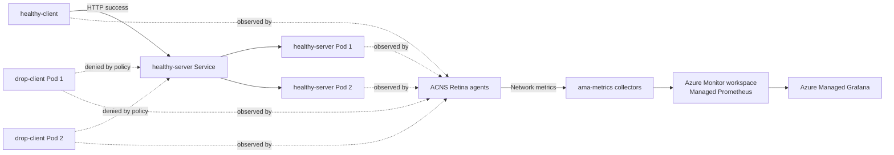
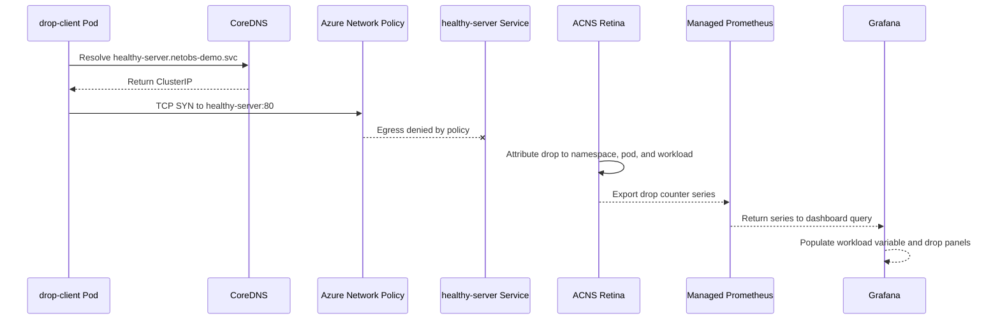

# AKS Pod Network Drops and Pod Recovery Demo Guide

> **Public version:** resource names are examples and environment-specific account/workspace values are placeholders. Captured evidence, screenshots, and exported guides remain local and are excluded from GitHub. This Markdown guide does not require those assets.

**Environment validated:** 5 September 2026  
**Audience:** Azure platform, Kubernetes, networking, and operations teams  
**Purpose:** Deploy and demonstrate pod-level packet-drop visibility and pod replacement monitoring on Azure Kubernetes Service (AKS).

## 1. Executive summary

This solution creates an Azure CNI Overlay AKS cluster, enables Advanced Container Networking Services (ACNS) Container Network Observability, sends metrics to Azure Managed Prometheus, and visualizes them in Azure Managed Grafana.

The demonstration covers two operational scenarios:

1. **Pod packet drops:** two pods repeatedly connect to the healthy service while an egress NetworkPolicy denies their traffic. ACNS observes policy drops and exports counters with pod, namespace, direction, and reason dimensions.
2. **Pod deletion and replacement:** one healthy server pod is deliberately deleted. Its Deployment creates a replacement, demonstrating workload resilience and lifecycle reporting.

The scenarios are intentionally reported differently. Packet loss is a network data-plane event shown through ACNS drop metrics. Pod deletion is a Kubernetes lifecycle event shown through pod count, status, and start-time metrics.

### Is ACNS enablement alone sufficient?

It depends on the objective:

- **Observe real customer network drops:** enabling ACNS and Managed Prometheus is sufficient to begin collecting supported network-drop events that naturally occur in the cluster. A workload appears in the Drops dashboard only after it has emitted a qualifying drop time series within the selected time range.
- **Prove the feature during a controlled demonstration:** enablement alone is not sufficient because a healthy cluster may have no drops. Deploy a safe, isolated workload and create a deterministic data-plane drop, such as the namespace-scoped NetworkPolicy scenario in this guide.
- **Monitor pod deletion or application failure:** network-drop telemetry is not the primary signal. Use Kubernetes state, events, logs, and pod lifecycle metrics. ACNS does not turn every failed request or deleted pod into a packet-drop metric.

The key distinction is between an **unsuccessful application connection** and a **packet that the observed data plane explicitly drops**. Only the latter is expected to populate a packet-drops dashboard.

## 2. Validated reference environment

| Item | Validated value |
|---|---|
| Subscription | `<subscription-name>` |
| Resource group | `rg-aks-netobs-demo` |
| Region | `swedencentral` |
| AKS cluster | `aks-overlay-netobs-demo` |
| Kubernetes version | `1.35.7` |
| Node count and size | 2 x `Standard_D2s_v5` |
| Network plugin | Azure CNI |
| Network mode | Overlay |
| Pod CIDR | `192.168.0.0/16` |
| Azure Monitor workspace | `amw-overlay-netobs-demo` |
| Azure Managed Grafana | `<grafana-name>` |
| Grafana version | `12.4.8` |
| Grafana endpoint | Resolve `properties.endpoint` from your own Grafana resource |
| Demo namespace | `netobs-demo` |

## 3. Architecture



### Data flow

1. Azure CNI Overlay assigns pod addresses from `192.168.0.0/16`.
2. ACNS deploys Retina agents to observe pod and node network activity.
3. `ama-metrics` collects Kubernetes and ACNS metrics.
4. A Data Collection Endpoint and Data Collection Rule route metrics into the Azure Monitor workspace.
5. Azure Managed Grafana queries the workspace and supplies managed Kubernetes networking dashboards.

### Exact simulated packet flow

The working drop demonstration follows this sequence:



1. `drop-client` resolves the healthy service through CoreDNS. The policy explicitly permits DNS on TCP/UDP port 53.
2. The pod sends an HTTP connection attempt to the resolved `healthy-server` ClusterIP.
3. Azure Network Policy denies application egress from pods labeled `app=drop-client`.
4. Retina observes the policy drop and associates it with Kubernetes metadata.
5. `ama-metrics` forwards the resulting series into the Azure Monitor workspace.
6. The Grafana dashboard queries drop series for the selected cluster and namespace.
7. The workload dropdown is populated from workloads that have matching drop series, not from every Deployment in Kubernetes.

The healthy comparison follows the same DNS and Service path but is not selected by the deny policy, so it receives an HTTP 200 response.

## 4. Resources created

The deployment creates or configures:

- One resource group.
- One AKS cluster with system-assigned managed identity.
- Azure CNI Overlay networking and a dedicated pod CIDR.
- ACNS Container Network Observability.
- One Azure Monitor workspace for Managed Prometheus.
- One Azure Managed Grafana workspace with managed identity.
- Managed Prometheus Data Collection Endpoint and Data Collection Rule.
- Kubernetes and node recording-rule groups used by managed dashboards.
- One test namespace containing three Deployments and one Service.

## 5. Customer prerequisites

### Access

The operator needs permission to:

- Create or update AKS, Azure Monitor, Grafana, managed identity, and data collection resources.
- Obtain AKS credentials and deploy namespace-scoped Kubernetes resources.
- Open Azure Managed Grafana and query its Prometheus data source.

Use least-privilege customer roles. Avoid granting subscription Owner solely for this demonstration.

### Tools

- Azure CLI 2.56 or newer.
- `kubectl` compatible with the target AKS version.
- PowerShell 7 or Windows PowerShell 5.1.
- An authenticated Azure session: `az login --tenant <tenant>`.
- A selected subscription: `az account set --subscription <subscription-id-or-name>`.

### Design decisions to confirm

- Supported Azure region and AKS version for ACNS.
- Azure CNI or Azure CNI Overlay networking.
- Kubernetes NetworkPolicy enforcement for generating deterministic policy drops.
- Customer approval for continuous synthetic failed connections.
- Retention, access, network exposure, and cost requirements for Azure Monitor and Grafana.

> The deny policy selects only pods labeled `app=drop-client`. Review this selector carefully so customer workloads cannot be affected.

### Existing-cluster compatibility gate

Before enabling anything, record the current networking configuration:

```powershell
$resourceGroup = "<customer-resource-group>"
$clusterName = "<customer-aks-cluster>"

az aks show -g $resourceGroup -n $clusterName `
  --query '{kubernetesVersion:kubernetesVersion,networkPlugin:networkProfile.networkPlugin,networkPluginMode:networkProfile.networkPluginMode,networkPolicy:networkProfile.networkPolicy,networkDataplane:networkProfile.networkDataplane,podCidrs:networkProfile.podCidrs,provisioningState:provisioningState}' `
  -o json
```

Do not assume an existing cluster matches this reference design. Confirm current Microsoft support for the customer's region, Kubernetes version, network plugin, dataplane, and ACNS feature set. Enabling or changing Network Policy can affect cluster networking and must pass the customer's change process and regression testing.

For observation only, do not enable Network Policy merely because ACNS is being enabled. Network Policy is required here to generate a deterministic demonstration drop, not as a universal prerequisite for collecting naturally occurring drops.

### Customer implementation choices

Choose one path before deployment:

| Path | Intended outcome | Synthetic workload required | Network Policy change required |
|---|---|---:|---:|
| Production observation | Collect naturally occurring supported network drops | No | No, unless already part of the customer's design |
| Controlled demo | Guarantee a visible, attributable drop signal | Yes | Yes for this policy-deny scenario |
| Pod recovery demo | Show Deployment self-healing | Yes | No |

For production observation, enable telemetry first and let customer traffic remain unchanged. For a controlled demo, use a disposable namespace and the narrowly scoped policy from this repository.

## 6. Installation from the beginning

### Customer implementation runbook

The following sequence is the recommended customer-side process. Separate platform enablement from demo traffic generation so each layer can be validated independently.

#### Phase A: discovery and approval

1. Identify the subscription, tenant, resource group, AKS cluster, region, and cluster owners.
2. Capture the current network plugin, plugin mode, dataplane, Network Policy engine, Kubernetes version, and pod/service CIDRs.
3. Decide whether the goal is production observation, a controlled demonstration, or both.
4. Obtain approval for Azure Monitor workspace and Grafana creation or reuse.
5. Obtain approval for ACNS enablement and expected monitoring cost.
6. If using the synthetic policy-drop scenario, obtain explicit approval for Network Policy enablement and the disposable namespace.
7. Confirm image-registry policy. Mirror `curlimages/curl:8.12.1` into the customer ACR if public pulls are prohibited.

#### Phase B: observability platform enablement

1. Create or identify an Azure Monitor workspace in an approved region.
2. Create or identify Azure Managed Grafana.
3. Confirm the Grafana managed identity and RBAC access to the Monitor workspace.
4. Enable ACNS Container Network Observability on AKS.
5. Enable Managed Prometheus on AKS and associate both resource IDs.
6. Wait for the AKS update to reach `Succeeded`.
7. Validate Retina and `ama-metrics` before deploying synthetic traffic.

Example commands for an existing compatible cluster:

```powershell
$subscription = "<subscription-id>"
$resourceGroup = "<aks-resource-group>"
$clusterName = "<aks-cluster>"
$location = "<supported-region>"
$monitorResourceGroup = "<monitor-resource-group>"
$monitorName = "<azure-monitor-workspace>"
$grafanaResourceGroup = "<grafana-resource-group>"
$grafanaName = "<managed-grafana-name>"

az account set --subscription $subscription

az resource create `
  -g $monitorResourceGroup `
  --namespace Microsoft.Monitor `
  --resource-type accounts `
  -n $monitorName `
  -l $location `
  --properties '{}'

az grafana create `
  -g $grafanaResourceGroup `
  -n $grafanaName `
  -l $location

$monitorId = az resource show `
  -g $monitorResourceGroup `
  -n $monitorName `
  --resource-type Microsoft.Monitor/accounts `
  --query id -o tsv

$grafanaId = az grafana show `
  -g $grafanaResourceGroup `
  -n $grafanaName `
  --query id -o tsv

az aks update -g $resourceGroup -n $clusterName --enable-acns

az aks update -g $resourceGroup -n $clusterName `
  --enable-azure-monitor-metrics `
  --azure-monitor-workspace-resource-id $monitorId `
  --grafana-resource-id $grafanaId
```

If the Monitor or Grafana resources already exist, reuse them according to the customer's ownership and RBAC model rather than creating duplicates.

#### Phase C: validate telemetry without synthetic failures

```powershell
az aks get-credentials -g $resourceGroup -n $clusterName --overwrite-existing
kubectl get nodes
kubectl get pods -n kube-system | Select-String "retina|ama-metrics"
```

Pass criteria:

- AKS provisioning state is `Succeeded`.
- Every node is Ready.
- One Retina agent is Ready per node and the Retina operator is Ready.
- Managed Prometheus collectors are Ready.
- Grafana opens and contains the expected Azure Monitor workspace data source.
- General Kubernetes metrics return data in Grafana Explore.

At this point, real customer drops can be observed if they occur. An empty Drops dashboard is not proof of a failed installation; it can mean no qualifying drops occurred during the selected time range.

#### Phase D: optionally enable deterministic demo drops

This phase is required only when the customer needs a guaranteed demonstration signal.

1. Confirm the cluster has an approved Network Policy engine. For this reference implementation:

   ```powershell
   az aks update -g $resourceGroup -n $clusterName --network-policy azure
   ```

2. Wait for AKS provisioning to succeed and run customer network regression tests.
3. Review the `app=drop-client` selector and namespace names in `pod-drop-demo.yaml`.
4. Apply the manifest:

   ```powershell
   kubectl apply -f .\pod-drop-demo.yaml
   kubectl rollout status deployment/drop-client -n netobs-demo --timeout=180s
   kubectl rollout status deployment/healthy-server -n netobs-demo --timeout=180s
   kubectl rollout status deployment/healthy-client -n netobs-demo --timeout=180s
   ```

5. Prove isolation before opening Grafana:

   ```powershell
   $dropPod = kubectl get pod -n netobs-demo -l app=drop-client -o jsonpath='{.items[0].metadata.name}'
   $healthyPod = kubectl get pod -n netobs-demo -l app=healthy-client -o jsonpath='{.items[0].metadata.name}'

   kubectl exec -n netobs-demo $dropPod -- curl -sS --connect-timeout 3 http://healthy-server
   kubectl exec -n netobs-demo $healthyPod -- curl -fsS --max-time 3 http://healthy-server
   ```

Expected result: the drop client times out and the healthy client returns `ok`.

#### Phase E: validate Grafana reporting

1. Allow 5-10 minutes for ingestion and variable refresh.
2. Open the managed **Kubernetes / Networking / Drops (Workload)** dashboard.
3. Select the Azure Monitor workspace, customer cluster, and test namespace.
4. Set the time range to **Last 30 minutes** for initial validation.
5. Refresh dashboard variables.
6. Select the current ReplicaSet-backed workload value, such as `drop-client-848598cf47`.
7. Confirm a non-zero policy-drop series and capture the drop reason/direction labels exposed by the installed version.
8. Compare against the healthy workload.
9. Use Explore queries to validate independently of dashboard panels.

#### Phase F: operationalize or remove

1. Delete `netobs-demo` after the demonstration unless ongoing synthetic testing is approved.
2. Keep ACNS and Managed Prometheus only if accepted into the customer's operational monitoring design.
3. Define dashboard ownership, access, retention, alert thresholds, and incident response.
4. Consider alerts on sustained drop rate grouped by production namespace/workload, after baselining expected behavior.
5. Record cost, RBAC, support, and rollback decisions in the customer's change record.

### Step 1: authenticate and verify context

```powershell
az login --tenant <customer-tenant>
az account set --subscription <customer-subscription>
az account show --query '{name:name,id:id,tenantId:tenantId}' -o table
az version
kubectl version --client
```

Do not proceed until the account, tenant, and subscription match the approved customer environment.

### Step 2: review deployment parameters

The script defaults are:

```powershell
$ResourceGroup = "rg-aks-netobs-demo"
$Location = "swedencentral"
$ClusterName = "aks-overlay-netobs-demo"
$AzureMonitorWorkspaceName = "amw-overlay-netobs-demo"
```

The Grafana name is generated as `amg-netobs-<first-eight-subscription-id-characters>` because Grafana workspace names must be globally unique.

### Step 3: deploy the Azure resources and test workloads

```powershell
Set-Location <repository-folder>
.\deploy-demo.ps1
```

To override defaults:

```powershell
.\deploy-demo.ps1 `
  -ResourceGroup "rg-customer-aks-netobs" `
  -Location "<supported-region>" `
  -ClusterName "aks-customer-netobs" `
  -AzureMonitorWorkspaceName "amw-customer-netobs" `
  -GrafanaName "amg-customer-netobs-<unique-suffix>"
```

The script performs these actions:

1. Creates the resource group.
2. Creates or reuses the Azure Monitor workspace.
3. Creates or reuses Azure Managed Grafana and enables its system-assigned identity.
4. Creates the AKS cluster with Azure CNI Overlay and Azure Network Policy if it does not exist.
5. Starts the cluster if it is stopped.
6. Enables Azure Network Policy and ACNS.
7. Enables Azure Monitor metrics and associates the Monitor and Grafana resources.
8. Obtains cluster credentials.
9. Applies the demo manifest.
10. Waits for all three Deployments to complete rollout.

The script is idempotent for this demonstration: rerunning it reconciles the expected configuration and Kubernetes objects.

### Step 4: understand the demo workloads

| Workload | Replicas | Purpose |
|---|---:|---|
| `drop-client` | 2 | Calls `healthy-server` every 0.2 seconds while an egress NetworkPolicy denies the traffic, producing deterministic policy drops. |
| `healthy-server` | 2 | Serves a minimal HTTP 200 response on port 8080. |
| `healthy-client` | 1 | Calls the `healthy-server` Service every 0.2 seconds to provide a healthy baseline. |
| `healthy-server` Service | N/A | Exposes the healthy server pods on cluster port 80. |

All workloads have small CPU and memory requests and limits. They are test workloads, not production application components.

## 7. Post-installation validation

### Validate Azure configuration

```powershell
az aks show -g rg-aks-netobs-demo -n aks-overlay-netobs-demo `
  --query '{state:provisioningState,power:powerState.code,plugin:networkProfile.networkPlugin,mode:networkProfile.networkPluginMode,podCidr:networkProfile.podCidr}' `
  -o table

az resource list -g rg-aks-netobs-demo `
  --query '[].{name:name,type:type,location:location}' -o table
```

Expected values include `Succeeded`, `Running`, `azure`, `overlay`, and the chosen pod CIDR. The resource list must include the AKS cluster, Monitor workspace, Grafana workspace, Prometheus DCE/DCR, and recording-rule groups.

### Validate Kubernetes workloads

```powershell
kubectl get nodes
kubectl get deployments,pods,services -n netobs-demo -o wide
```

Expected state:

- Both nodes are `Ready`.
- `drop-client` has 2/2 available replicas.
- `healthy-server` has 2/2 available replicas.
- `healthy-client` has 1/1 available replica.
- Every demo pod is `Running` and Ready.

### Validate observability collectors

```powershell
kubectl get pods -n kube-system | Select-String "ama-metrics|retina"
```

Expected components:

- One `retina-agent` per node.
- One Ready `retina-operator`.
- `ama-metrics` replicas.
- One `ama-metrics-node` per node.
- `ama-metrics-ksm` for Kubernetes object-state metrics.

### Live validation evidence


At the captured validation point, both nodes were Ready; all five demo pods were Running; two Retina agents, the Retina operator, and all Managed Prometheus collectors were Running.

## 8. Demonstration scenario 1: pod packet drops

### Objective

Show that ACNS attributes network drops to Kubernetes workloads instead of exposing only aggregate node counters.

### What happens

Each `drop-client` calls the healthy service:

```sh
curl --connect-timeout 1 http://healthy-server
```

The `deny-drop-client-egress` policy allows DNS to `kube-system` but denies other egress from selected pods. Denied attempts continue every 0.2 seconds. Retina observes the application traffic policy drops and emits metrics. The healthy client/server traffic supplies a comparison.

### Why `drop-client` was missing earlier

The first version sent HTTP requests to the unused address `192.168.255.254:65000`. Those requests timed out, but a timeout does not prove that the observed dataplane discarded a packet. It can result from unanswered address resolution, routing, no listener, silent network behavior, or an application connect timeout. The Drops dashboard is based on emitted drop-counter series, not on failed `curl` exit codes.

Consequently:

1. The `drop-client` Deployment and ReplicaSet existed and its pods were Running.
2. The curl commands failed, but no qualifying `drop-client` drop series populated the dashboard query.
3. Grafana's workload dropdown was derived from workloads present in matching drop metrics, not from `kubectl get deployments`.
4. `healthy-client-7f8b9d4c8b` appeared because a drop series existed for that ReplicaSet during the selected interval; this did not mean every healthy request was dropped.
5. After Azure Network Policy was enabled and an explicit egress deny was applied, the dataplane produced deterministic policy-drop events for `drop-client`.
6. Updating the Deployment changed its pod-template hash, so the selectable Grafana value became a ReplicaSet-style name such as `drop-client-848598cf47`, not simply `drop-client`.

This behavior is important in customer environments: a workload selector can be absent because it has no matching series in the chosen time window, even while the workload is healthy and visible in Kubernetes.

### Dashboard variable behavior

- The namespace variable limits the drop-series search.
- The workload variable is populated from matching metric labels and may use the ReplicaSet-derived workload name.
- A Deployment rollout changes the ReplicaSet hash and therefore can create a new workload value.
- Old and new values can coexist when the dashboard time range spans both ReplicaSets.
- Widening the time range can reveal old values but cannot create a series that was never emitted.
- After changing traffic or policy, wait for ingestion and manually refresh variables.

### Presenter flow

1. Show that all pods are Running: `kubectl get pods -n netobs-demo -o wide`.
2. Explain that a Running pod can still experience network failure.
3. Open Grafana and select a 15-minute time range.
4. Navigate to **Dashboards > Azure Managed Prometheus > Kubernetes / Networking / Drops (Workload)**.
5. Select cluster `aks-overlay-netobs-demo`, namespace `netobs-demo`, and workload `drop-client`.
6. Point out drop rate, direction, reason, pod, and workload dimensions available in the dashboard.
7. Change the workload to `healthy-client` to demonstrate the contrast.
8. Open Explore and show the raw PromQL query.

### PromQL queries

Drop rate by pod and reason:

```promql
sum by (cluster, instance, source, reason) (
  rate(hubble_drop_total{source=~"netobs-demo/.*"}[5m])
)
```

Drop increase by direction and reason:

```promql
sum by (source, destination, reason) (
  increase(hubble_drop_total{source=~"netobs-demo/.*"}[10m])
)
```

If the exact metric or label set differs in a future ACNS release, begin in Explore with metric search for `drop`, inspect the available labels, and adjust the aggregation without assuming a label exists.

### Expected report

- `drop-client` shows a sustained non-zero drop signal.
- Results can be grouped by namespace and pod.
- A reason and direction are shown when exported by the installed ACNS version.
- `healthy-client` should show materially lower or no equivalent drop rate.

### Screenshot procedure

1. Set **Last 15 minutes** and refresh.
2. Select the cluster, `netobs-demo`, and `drop-client` variables.
3. Expand the panel containing the clearest non-zero series.
4. Capture the browser viewport with the dashboard title, selectors, time range, legend, and graph visible.
5. Store the image as `docs/images/grafana-workload-drops.png`.
6. Replace the following capture placeholder when distributing outside this validated environment.

> **Grafana screenshot capture point:** Kubernetes / Networking / Drops (Workload), filtered to `drop-client`. The authenticated Grafana browser view must be captured by the customer because screenshots can contain subscription, cluster, and tenant metadata.

## 9. Demonstration scenario 2: pod deletion and recovery

### Objective

Show Kubernetes self-healing and explain the difference between pod lifecycle events and packet-drop events.

### Execute

```powershell
.\invoke-pod-kill.ps1
```

The script:

1. Selects a Ready `healthy-server` pod.
2. Records the deletion timestamp and pod name.
3. Deletes the selected pod.
4. Waits until that exact pod is gone.
5. Waits for a differently named Ready replacement.
6. Prints the current healthy server pods.

Validated example:

```text
Deleting pod/healthy-server-85985499f8-ndj5w ...
Replacement ready: healthy-server-85985499f8-bdxht
```

### Grafana reporting

Open **Dashboards > Azure Managed Prometheus > Kubernetes / Compute Resources / Namespace (Pods)** and select:

- Cluster: `aks-overlay-netobs-demo`
- Namespace: `netobs-demo`
- Time range: **Last 15 minutes**

Use Explore for precise evidence.

Running healthy-server pods:

```promql
sum(
  kube_pod_status_phase{
    namespace="netobs-demo",
    pod=~"healthy-server-.*",
    phase="Running"
  }
)
```

Pod start times:

```promql
max by (pod) (
  kube_pod_start_time{
    namespace="netobs-demo",
    pod=~"healthy-server-.*"
  }
)
```

Recent container restarts, useful for crashes but not direct pod deletion:

```promql
sum by (pod, container) (
  increase(kube_pod_container_status_restarts_total{namespace="netobs-demo"}[15m])
)
```

### Interpretation

- The deleted pod name disappears.
- A new pod name and start timestamp appear.
- Desired and available replicas return to two.
- Container restart count normally remains zero because Kubernetes created a new pod rather than restarting the old container.
- A direct pod deletion does not have to increase `hubble_drop_total`. Use lifecycle metrics for this scenario.

### Screenshot procedure

1. Open the namespace pod dashboard before deletion.
2. Set **Last 15 minutes** and note the current healthy server pod names.
3. Run `invoke-pod-kill.ps1` and record its timestamp.
4. Refresh Grafana after the replacement appears.
5. Capture pod-count/status panels and an Explore result showing the new pod start time.
6. Store images as `docs/images/grafana-pod-replacement.png` and `docs/images/grafana-pod-start-time.png`.

> **Grafana screenshot capture point:** Namespace (Pods) dashboard and Explore start-time query, with customer-sensitive identifiers reviewed before distribution.

## 10. Reporting delivered by the solution

| Report or signal | Source | Operational use |
|---|---|---|
| Workload drop rate | ACNS/Retina network metric | Identify which pod or namespace is losing traffic. |
| Drop reason and direction | ACNS metric labels | Distinguish ingress/egress and reported failure classes. |
| Healthy versus failing workload | Managed networking dashboard | Compare expected traffic with intentionally failing traffic. |
| Pod phase and pod count | kube-state-metrics | Detect Pending, Failed, or changing pod availability. |
| Pod start time | kube-state-metrics | Prove that a replacement pod was created. |
| Container restart increase | kube-state-metrics | Detect container crashes or restart loops; not equivalent to pod replacement. |
| Node and collector readiness | Kubernetes API | Confirm the monitoring pipeline is operational. |

## 11. Troubleshooting

### No data in Grafana

1. Wait at least 5-10 minutes after first enablement.
2. Confirm the correct Azure Monitor workspace data source is selected.
3. Confirm Grafana has access to the workspace and its managed identity is enabled.
4. Confirm `ama-metrics` and `ama-metrics-node` are Ready.
5. Confirm the Prometheus DCE and DCR exist.
6. Expand the time range to 30 minutes.
7. Search available metrics in Explore instead of assuming a metric name.

### No network-drop metric

```powershell
kubectl get pods -n kube-system | Select-String "retina"
az aks show -g <resource-group> -n <cluster-name> -o json
```

Confirm ACNS is enabled and Retina has one agent per node. Verify that `deny-drop-client-egress` exists, selects `app=drop-client`, and is enforced by the cluster dataplane.

Use this ordered diagnosis:

1. Confirm the workload and current ReplicaSet exist:

  ```powershell
  kubectl get deploy,rs,pods -n netobs-demo -o wide
  ```

2. Confirm Network Policy is configured on AKS:

  ```powershell
  az aks show -g <resource-group> -n <cluster-name> `
    --query '{networkPolicy:networkProfile.networkPolicy,dataplane:networkProfile.networkDataplane}' -o json
  ```

3. Confirm the deny policy exists and selects only the synthetic pods:

  ```powershell
  kubectl describe networkpolicy deny-drop-client-egress -n netobs-demo
  ```

4. Confirm DNS resolves from `drop-client`, then confirm application traffic times out.
5. Confirm the same service call succeeds from `healthy-client`.
6. Confirm Retina and `ama-metrics` are Ready.
7. In Grafana, select the correct workspace, cluster, namespace, and a 30-minute range.
8. Refresh variables and look for the current `drop-client-<replicaset-hash>` value.
9. Use Explore to search drop metrics directly. If no series exists, troubleshoot collection or policy enforcement rather than the dropdown.

### Demo pod is not Running

```powershell
kubectl describe pod <pod-name> -n netobs-demo
kubectl logs <pod-name> -n netobs-demo
kubectl get events -n netobs-demo --sort-by=.lastTimestamp
```

Common causes include blocked public image registries, image policy, admission policy, insufficient capacity, and DNS or outbound restrictions. In restricted environments, mirror `curlimages/curl:8.12.1` into the customer Azure Container Registry and update the manifest.

### `kubectl` not found

```powershell
az aks install-cli
$env:Path += ";$HOME\.azure-kubectl"
```

The included kill script also checks `$HOME\.azure-kubectl\kubectl.exe` when `kubectl` is absent from PATH.

### Pod deletion appears to have no restart

This is expected. Deleting a pod causes the Deployment controller to create a new pod. Watch the pod name, UID, creation time, and `kube_pod_start_time`; do not rely only on container restart counters.

## 12. Security, governance, and cost considerations

- Deploy synthetic failure workloads only in an approved test namespace.
- Do not target customer services, external systems, or addresses outside the approved test range.
- Use Azure RBAC and Grafana roles with least privilege.
- Review public network access requirements for Grafana and Azure Monitor before production adoption.
- Use managed identities instead of stored credentials.
- Apply customer naming, tagging, policy, region, private networking, and diagnostic standards.
- Confirm metric retention and expected Managed Prometheus/Grafana costs.
- Treat screenshots as potentially sensitive because they may expose tenant, subscription, cluster, namespace, workload, and topology details.
- Remove the traffic generator immediately after the demonstration if continuous failed connections are not approved.

## 13. Cleanup

Remove only the synthetic workloads while retaining observability:

```powershell
kubectl delete namespace netobs-demo
```

Remove the complete disposable environment:

```powershell
az group delete --name rg-aks-netobs-demo --yes --no-wait
```

For a shared customer cluster, do not delete shared Monitor or Grafana resources. Remove only the namespace and any associations/resources created exclusively for the demonstration after confirming ownership.

## 14. Demo completion checklist

- [ ] Correct tenant and subscription confirmed.
- [ ] AKS provisioning state is Succeeded and both nodes are Ready.
- [ ] Network plugin is Azure CNI and mode is Overlay.
- [ ] ACNS is enabled and Retina components are Ready.
- [ ] Managed Prometheus components and DCE/DCR are present.
- [ ] Grafana opens and the Azure Monitor workspace data source is available.
- [ ] All five demo pods are Running.
- [ ] `drop-client` produces a non-zero workload drop signal.
- [ ] `healthy-client` provides a low-drop comparison.
- [ ] Pod kill creates a newly named Ready replacement.
- [ ] Screenshots show filters, time range, graph legend, and timestamp.
- [ ] Synthetic workloads are removed or formally accepted after the demo.

## 15. Source artifacts

- `deploy-demo.ps1`: Azure resource provisioning and workload deployment.
- `pod-drop-demo.yaml`: synthetic drop and healthy baseline workloads.
- `invoke-pod-kill.ps1`: controlled pod deletion and replacement validation.
- `live-validation.txt`: timestamped validation output.
- `images/live-validation.png`: screenshot evidence of runtime readiness.

## 16. References

- Microsoft Learn: [Set up Container Network Observability for AKS](https://learn.microsoft.com/azure/aks/container-network-observability-how-to?tabs=non-cilium)
- Microsoft Learn: [Azure Monitor managed service for Prometheus](https://learn.microsoft.com/azure/azure-monitor/essentials/prometheus-metrics-overview)
- Microsoft Learn: [Azure Managed Grafana](https://learn.microsoft.com/azure/managed-grafana/overview)